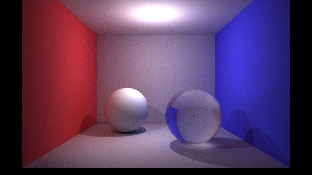

# MyRender

MyRender 是用 C++17 编写的 CPU 路径追踪渲染器。它从 XML 读取相机、物体、材质和灯光，计算直接光照与多次反弹，再用 MiniFB 显示图像。



*默认场景预览，640 × 360，每像素 512 次采样。右侧玻璃球同时显示透射和镜面反射。*

## 构建与运行

以下命令使用 Windows 上的 CMake 3.16 或更新版本、Ninja 和支持 C++17 的 MinGW-w64。确保 `cmake`、`ninja`、`gcc` 和 `g++` 都能从 PowerShell 调用，在仓库根目录运行：

```powershell
cmake -S . -B build -G Ninja -DCMAKE_BUILD_TYPE=Release -DCMAKE_C_COMPILER=gcc -DCMAKE_CXX_COMPILER=g++
cmake --build build
.\build\MyRender.exe
```

在 Rider 中可以直接打开仓库的 [CMakeLists.txt](CMakeLists.txt)，运行 `MyRender` 目标，并把运行配置的工作目录设为仓库根目录。场景路径是相对工作目录解析的，CMake 也会把两个示例 XML 复制到构建目录。

## 选择场景

| 场景 | 内容 |
| --- | --- |
| [scene08.xml](scenes/scene08.xml) | 红蓝墙康奈尔盒，两个漫反射球 |
| [scene09.xml](scenes/scene09.xml) | 默认场景，左侧漫反射球，右侧透明玻璃球 |

在 [src/main.cpp](src/main.cpp) 修改 `Renderer` 构造函数最后一个参数即可切换场景。前五个参数依次是图像宽、高、开始使用俄罗斯轮盘终止光路的深度、最大深度、每像素采样数。默认使用 1920 × 1080 和每像素 1024 次采样。调试场景时，可以先降低分辨率和采样数来缩短等待时间。

## XML 格式

- `Camera` 定义相机位置、观察目标和视场角，`SceneObjects` 定义物体的变换和几何体。支持球体、圆盘和三角形。
- `Materials` 按名称定义材质，物体用 `<Material>材质名</Material>` 引用。支持 `Lambert` 漫反射、`ConductorSpecular` 金属镜面和 `DielectricSpecular` 玻璃等绝缘体材质。
- `Lights` 支持平行光、点光源和聚光灯。点光源和聚光灯的 `Attenuations` 依次是距离衰减的二次项、一次项和常数项。

向量可以用逗号分隔，物体旋转、相机视场角和聚光灯角度用度数填写。右侧玻璃球引用的材质如下：

```xml
<Material>
    <Name>M_Glass_Sphere</Name>
    <Type>DielectricSpecular</Type>
    <Eta>1.5</Eta>
    <TransmissionColor>1, 1, 1</TransmissionColor>
</Material>
```

## 代码入口

| 文件 | 职责 |
| --- | --- |
| [main.cpp](src/main.cpp) | 设置场景路径和渲染参数 |
| [SceneXmlLoader.cpp](src/SceneXmlLoader.cpp) | 读取 XML，创建并绑定场景对象、材质和灯光 |
| [Renderer.cpp](src/Renderer.cpp) | 生成采样、追踪光线、计算光照并显示图像 |
| [Material.cpp](src/Material.cpp) · [Light.cpp](src/Light.cpp) | 计算材质的反射和透射，以及光源的贡献 |

## 依赖与参考

[GLM](third_party/glm/copying.txt)、[MiniFB](third_party/minifb/LICENSE) 和 [TinyXML-2](third_party/tinyxml2/LICENSE.txt) 的源码已随仓库提供。Windows 使用 MiniFB 的 GDI 后端。

场景格式和示例参考了 [FortuneRenderer](https://github.com/woyaofacai/FortuneRenderer)《从零打造渲染器》课程。
